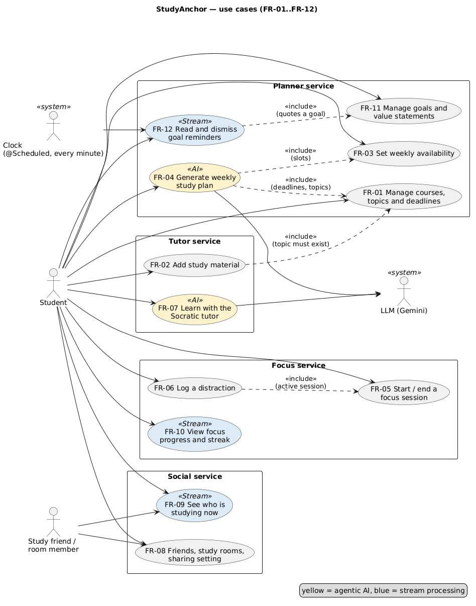
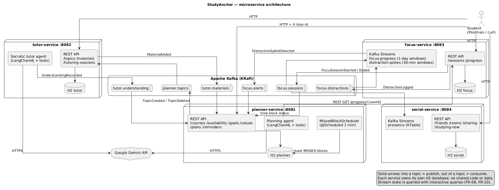

# 2. The big picture

This part explains what StudyAnchor does and how its four services work together. You don't need to read any code for this part.

> Origin: written by Claude (AI) from the project's docs and code, reviewed by the author.

---

## 2.1 What problem it solves

University students, especially students with ADHD, struggle with five things:

| Problem | What StudyAnchor does about it |
|---|---|
| **Planning paralysis**: too many courses and deadlines to turn into a plan | An **AI planning agent** builds a weekly timetable from deadlines and free time (FR-04) |
| **Distraction**: phones and social media break focus | **Focus sessions** with distraction logging; a **live detector** notices bursts of distractions (FR-05, FR-06, FR-12) |
| **Passive AI use**: chatbots just give the answer | A **Socratic AI tutor** gives hints first and the answer only after two real attempts (FR-07) |
| **Isolation**: studying alone makes it easy to stop | **Friends, study rooms** and a live **"studying now" board** (FR-08, FR-09) |
| **Losing the "why"**: motivation fades mid-semester | **Goals and values**, quoted back in reminders when focus slips (FR-11, FR-12) |

The five objectives (O1–O5) and the stakeholders are in [01-domain.md](../01-domain.md).

---

## 2.2 The twelve features

| FR | Feature | Service | Special technique |
|---|---|---|---|
| FR-01 | Manage courses, topics and deadlines | Planner | |
| FR-02 | Add study material to a topic (.txt, .md, .pdf) | Tutor | |
| FR-03 | Set weekly study availability | Planner | |
| FR-04 | AI-generated weekly study plan | Planner | **Agentic AI** |
| FR-05 | Start and end a focus session | Focus | |
| FR-06 | Log a distraction | Focus | |
| FR-07 | Socratic AI tutor | Tutor | **Agentic AI** |
| FR-08 | Friends, study rooms and sharing settings | Social | |
| FR-09 | Live "studying now" board | Social | **Stream processing** |
| FR-10 | Real-time focus progress and streak | Focus | **Stream processing** |
| FR-11 | Personal goals and value statements | Planner | |
| FR-12 | Contextual goal reminders | Focus → Planner | **Stream processing** trigger |

The spec asks for at least 2 stream-processing stories and at least 2 agentic-AI stories. We have 3 and 2. Full acceptance criteria are in [02-requirements.md](../02-requirements.md).

---

## 2.3 Four services, one job each

The system is split into four **bounded contexts**. Each is a separate Spring Boot app with its own port and its own database.

| Service | Port | Its one job | Owns this data |
|---|---|---|---|
| **planner-service** | 8081 | *What* to study, *when*, and *why* | Course, Topic, Deadline, Availability, StudyPlan, TimeBlock, Goal, ValueStatement, Reminder |
| **tutor-service** | 8082 | *Learning* the content | Material, TutoringSession, TopicReference (a copy) |
| **focus-service** | 8083 | *Doing* the study and measuring it | FocusSession, Distraction, progress (stream store) |
| **social-service** | 8084 | Studying *together* | Friendship, StudyRoom, SharingSetting, presence (stream store) |

**An analogy.** Think of four small shops on one street. Each shop has its own staff, its own storeroom (database) and its own counter (REST API). They never walk into each other's storeroom. When something happens that others might care about, a shop pins a notice on the **shared noticeboard** (Kafka). Any other shop can read the notices it is interested in.

**Rules that keep them independent:**
- No shared database: each service has its own in-memory H2 database.
- No shared code module: each service has its own copy of the event classes it reads.
- If one service is down, the others keep working. For example, Tutor keeps its own copy of topic names, so tutoring still works when Planner is off.

---

## 2.4 How the services talk

There are two ways:

| Way | When it is used | Example |
|---|---|---|
| **Kafka events** (asynchronous, "fire and forget") | Almost always: one service tells the others *something happened* | Focus publishes `FocusSessionEnded`; Social and Planner react |
| **REST call** (synchronous, "ask and wait") | Only once: Planner needs an answer right now | Planner's AI agent calls Focus `GET /progress/{userId}` |

Why mostly events? The sender doesn't need to know who is listening, and it doesn't wait. Adding a new listener later needs no change to the sender.

*How to read the diagram:* boxes are services. The long tube in the middle is Kafka, with one small cylinder per **topic**. An arrow *into* a topic means "publishes", and an arrow *out of* a topic means "consumes". Each service has its own H2 database. The cloud at the bottom is Google Gemini, the LLM that both AI agents call.

---

## 2.5 The six Kafka topics

A **topic** is a named channel on the noticeboard. Each event is a small JSON message. Its key is the `userId`, so all events of one student stay in order.

| Topic | Events on it | Written by | Read by | Why the reader cares |
|---|---|---|---|---|
| `planner.topics` | TopicCreated, TopicDeleted | Planner | Tutor | Tutor needs to know which topics exist before materials can be added |
| `tutor.materials` | MaterialAdded | Tutor | Planner | Planner shows how many materials each topic has |
| `tutor.understanding` | UnderstandingRecorded | Tutor | Planner | The planning agent prioritises topics the student understands least |
| `focus.sessions` | FocusSessionStarted, FocusSessionEnded | Focus | Social, Focus, Planner | Social: who is studying now. Focus: progress totals. Planner: mark time blocks done |
| `focus.distractions` | DistractionLogged | Focus | Focus (stream) | The spike detector counts distractions in 30-minute windows |
| `focus.alerts` | DistractionSpikeDetected | Focus (stream) | Planner | Planner creates a reminder quoting the student's own goal |

Every event has the same envelope: `eventId`, `eventType`, `occurredAt`, `userId`. Exact fields are in [05-events.md](../05-events.md).

---

## 2.6 One student's day, end to end

This walk-through shows all four services working together. Each step names the feature and the service.

1. **Morning, Planner (FR-01, FR-03, FR-11).** Alice adds her course *CSCI318*, the topics *Recursion* and *DDD*, an assignment due in two weeks (40 %), her free time (Mon 9–12), and a goal: *"Pass CSCI318, because I want to graduate this year."*
   → Planner publishes `TopicCreated` → **Tutor** stores a copy of each topic.
2. **Planner, AI agent (FR-04).** Alice asks for this week's plan. The planning agent (Gemini) calls tools to read her deadlines, free time, topics and focus history, then adds time blocks. The Java code refuses any block that breaks a rule: outside her free time, shorter than 25 or longer than 90 minutes, in the past, or less than 10 minutes after another block.
3. **Tutor (FR-02, FR-07).** Alice uploads lecture notes on Recursion → Tutor publishes `MaterialAdded` → Planner counts it. She asks the AI tutor a question. It gives hints and won't reveal the answer until she has tried twice. At the end it rates her understanding 1–5 → `UnderstandingRecorded` → Planner uses it to prioritise next week.
4. **Focus (FR-05).** Alice starts a 25-minute focus session → `FocusSessionStarted`:
   - **Social** (stream): her friends' "studying now" board shows her (FR-09), because she turned sharing on (FR-08).
   - **Planner**: the matching time block becomes `STARTED`.
5. **Focus (FR-06, FR-12).** She checks Instagram three times and logs it each time → `DistractionLogged` ×3 → the **spike detector** stream sees 3 in 30 minutes → `DistractionSpikeDetected` → **Planner** creates a reminder quoting her goal: *"Pass CSCI318, because I want to graduate this year."*
6. **Focus (FR-05, FR-10).** She ends the session → `FocusSessionEnded`:
   - **Focus** (stream) adds the minutes to today's total and the streak (FR-10).
   - **Social** removes her from "studying now".
   - **Planner** marks the time block `COMPLETED`. A block nobody started is marked `MISSED` and gets its own reminder.

You can watch steps 4–6 happen live in the service windows. See [01-run-it.md](01-run-it.md), *What to show while demoing*.

---

## 2.7 Technology in one table

| Need | Technology | Where |
|---|---|---|
| Language | Java 21 | all services |
| Web framework | Spring Boot 3.5, Spring Web | all services, `presentation` packages |
| Database | Spring Data JPA + H2 (in memory) | all services, `infrastructure` packages |
| Messaging | Apache Kafka 4.1 (Docker) + Spring Cloud Stream | `infrastructure` packages, `application.yml` |
| Stream processing | Kafka Streams (Spring Cloud Stream binder) | `*Topology.java` files |
| AI agents | LangChain4j + Google Gemini | `Gemini*Agent.java`, `*Tools.java` |
| PDF reading | Apache PDFBox (approved by the coordinator) | tutor-service `UploadedFileText.java` |
| Client / demo | Postman collection | `postman/` |

---

**Next:** [03: Inside one service](03-inside-a-service.md) opens a service up and follows one request through every layer.
