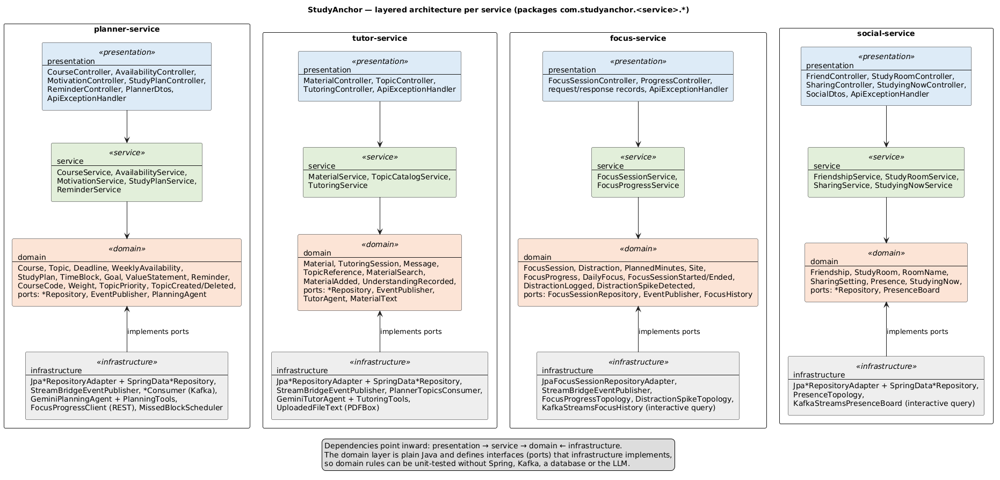

# 3. Inside one service: following one request through every layer

This part opens up **focus-service** and follows one real request, *"start a focus session"* (FR-05), from the moment it arrives until other services hear about it. All four services are built the same way, so once you understand this one, you understand them all.

> Origin: written by Claude (AI) from the project's code, reviewed by the author. Code snippets are copied from the repo; `…` marks lines left out.

---

## 3.1 The four layers

Every service has the same four packages (folders). Each package is one **layer**, and each layer has one job.

| Layer (package) | Job | Restaurant analogy | Allowed to know about |
|---|---|---|---|
| `presentation` | Turn HTTP requests into method calls, and results into JSON | **Waiter**: takes the order, brings the plate | `service`, `domain` |
| `service` | Run one use case step by step: load, call the domain, save, publish | **Manager**: "fetch the order, ask the chef, serve it, tell the bar" | `domain` |
| `domain` | The business rules and the data they protect | **Chef and recipe book**: decides what is allowed | *nothing else* (plain Java) |
| `infrastructure` | Talk to the outside world: database, Kafka, Gemini, other services | **Storeroom and delivery van** | `domain` (it implements the domain's interfaces) |

**The dependency rule.** Arrows point *inward*, toward the domain. The domain never imports Spring Web, Kafka or LangChain4j. When the domain needs something from outside (saving, publishing), it declares an **interface** (a "port"), and `infrastructure` provides the class that implements it (an "adapter"). This is called *ports and adapters*. It lets us test business rules without a database or Kafka.



---

## 3.2 Map of focus-service

Path: `focus-service/src/main/java/com/studyanchor/focus/`. These are the files used by FR-05; the others belong to FR-06, FR-10 and FR-12.

```
focus/
├── FocusServiceApplication.java          starts the Spring Boot app (port 8083)
├── presentation/
│   ├── FocusSessionController.java       REST endpoints /sessions …
│   ├── StartSessionRequest.java          the JSON body of POST /sessions
│   ├── SessionResponse.java              the JSON we send back
│   └── ApiExceptionHandler.java          turns domain errors into 400 / 404 / 409
├── service/
│   └── FocusSessionService.java          use cases: start, end, get
├── domain/
│   ├── FocusSession.java                 AGGREGATE ROOT: one focus session + its rules
│   ├── PlannedMinutes.java               VALUE OBJECT: 10–180 minutes
│   ├── FocusSessionStarted.java          DOMAIN EVENT
│   ├── FocusSessionEnded.java            DOMAIN EVENT
│   ├── DomainEvent.java                  what every event has (id, type, time, user)
│   ├── FocusSessionRepository.java       PORT: "save and find sessions" (interface)
│   ├── EventPublisher.java               PORT: "publish an event" (interface)
│   └── DomainException / ConflictException / NotFoundException
└── infrastructure/
    ├── JpaFocusSessionRepositoryAdapter.java   ADAPTER: implements the repository with JPA + H2
    ├── SpringDataFocusSessionRepository.java   Spring Data writes the SQL for us
    └── StreamBridgeEventPublisher.java         ADAPTER: implements EventPublisher with Kafka
```

Config: `focus-service/src/main/resources/application.yml` (port, H2 database, which Kafka topic each output goes to).

---

## 3.3 The journey of one request

The request we follow:

```http
POST http://localhost:8083/sessions
X-User-Id: alice
Content-Type: application/json

{"plannedMinutes": 25, "allowedSites": ["moodle.uow.edu.au"]}
```

The whole journey at a glance:

```
Postman
  │  POST /sessions
  ▼
[presentation] FocusSessionController.start ─────────────── step 1
  │  service.start(userId, …)
  ▼
[service]      FocusSessionService.start ─────────────────── step 2
  │  1. repository.hasActiveSession(userId)?  ── [infrastructure] JPA → H2   step 3
  │  2. FocusSession.start(…)                 ── [domain] rules + event      step 4–5
  │  3. repository.save(session)              ── [infrastructure] JPA → H2   step 6
  │  4. eventPublisher.publish(event)         ── [infrastructure] Kafka      step 7
  ▼
Kafka topic focus.sessions ──► social-service, planner-service, focus stream   step 8
  │
  ▼
201 Created + JSON back to Postman ────────────────────────── step 9
```

### Step 1. The controller receives the request (presentation)

`presentation/FocusSessionController.java`

```java
@RestController
@RequestMapping("/sessions")
class FocusSessionController {
    …
    @PostMapping
    ResponseEntity<SessionResponse> start(@RequestHeader("X-User-Id") String userId,
                                          @RequestBody StartSessionRequest request) {
        FocusSession session = service.start(userId, request.timeBlockId(), request.topicId(),
                request.plannedMinutes(), request.allowedSites());
        return ResponseEntity.created(URI.create("/sessions/" + session.id())).body(SessionResponse.from(session));
    }
```

- `@RestController` + `@RequestMapping("/sessions")`: Spring sends every request for `/sessions` to this class.
- `@PostMapping`: this method handles `POST /sessions`.
- `@RequestHeader("X-User-Id")`: reads who is calling. There is no login (a scope decision), so the student's ID travels in this header.
- `@RequestBody StartSessionRequest`: Spring turns the JSON into this Java object:

```java
public record StartSessionRequest(UUID timeBlockId, UUID topicId, Integer plannedMinutes, List<String> allowedSites) {
}
```

A `record` is a short way to write a class that only carries data. Notice there is **no validation here**: the controller does not check whether 25 is allowed. That is the domain's job (step 5).

### Step 2. The service runs the use case (service)

`service/FocusSessionService.java`

```java
@Transactional
public FocusSession start(String userId, UUID timeBlockId, UUID topicId, Integer plannedMinutes,
                          Collection<String> allowedSites) {
    if (repository.hasActiveSession(userId)) {
        throw new ConflictException("User " + userId + " already has an active focus session");
    }
    FocusSession session = FocusSession.start(userId, timeBlockId, topicId, plannedMinutes, allowedSites,
            clock.instant());
    return saveAndPublish(session);
}
```

The service is a **coordinator**: it reads like a to-do list.
1. Ask the repository: does this student already have an active session? If yes → `ConflictException` (becomes HTTP **409**).
2. Ask the domain to create the session.
3. Save it and publish its events.

`@Transactional` means "all database work in this method succeeds together or not at all". `clock.instant()` is "now". The clock is injected so tests can fix the time.

### Step 3. Checking the database (infrastructure, through a port)

The service only knows the **interface** `domain/FocusSessionRepository.java`:

```java
public interface FocusSessionRepository {
    FocusSession save(FocusSession session);
    Optional<FocusSession> findByIdAndUserId(UUID id, String userId);
    boolean hasActiveSession(String userId);
}
```

The **adapter** `infrastructure/JpaFocusSessionRepositoryAdapter.java` implements it:

```java
@Repository
class JpaFocusSessionRepositoryAdapter implements FocusSessionRepository {
    …
    @Override
    public boolean hasActiveSession(String userId) {
        return jpa.existsByUserIdAndEndedAtIsNull(userId);
    }
```

And `SpringDataFocusSessionRepository` has no code at all. Spring Data reads the method name and writes the SQL itself:

```java
interface SpringDataFocusSessionRepository extends JpaRepository<FocusSession, UUID> {
    Optional<FocusSession> findByIdAndUserId(UUID id, String userId);
    boolean existsByUserIdAndEndedAtIsNull(String userId);
}
```

`existsByUserIdAndEndedAtIsNull` becomes roughly `SELECT … WHERE user_id = ? AND ended_at IS NULL`: "a session for this user that has not ended".

### Step 4. The aggregate creates itself (domain)

`domain/FocusSession.java`: the **aggregate root**. It is the only way to create or change a focus session.

```java
public static FocusSession start(String userId, UUID timeBlockId, UUID topicId, Integer plannedMinutes,
                                 Collection<String> allowedSites, Instant now) {
    if (userId == null || userId.isBlank()) {
        throw new DomainException("userId is required");
    }
    FocusSession session = new FocusSession();
    session.id = UUID.randomUUID();
    session.userId = userId;
    session.timeBlockId = timeBlockId;
    session.topicId = topicId;
    session.plannedMinutes = PlannedMinutes.of(plannedMinutes);       // ← rule check, step 5
    if (allowedSites != null) {
        for (String site : allowedSites) {
            Site cleaned = Site.of(site);                             // "https://www.Moodle…/x" → "moodle…"
            if (cleaned != null) {
                session.allowedSites.add(cleaned.host());
            }
        }
    }
    session.startedAt = now;
    session.domainEvents.add(FocusSessionStarted.of(session));        // ← records "this happened"
    return session;
}
```

Three things to notice:
- **No public setters.** Nobody outside can write `session.endedAt = …`. Changes go only through `start(…)`, `end(…)` and `logDistraction(…)`, so the rules can't be skipped.
- **It records an event** (`FocusSessionStarted`) in a private list. It does **not** send it yet, because the domain knows nothing about Kafka.
- `@Entity` on the class tells JPA to store it in the `focus_session` table. (This is a small, deliberate shortcut: the domain class carries JPA annotations instead of having a separate database class.)

### Step 5. The value object checks the rule (domain)

`domain/PlannedMinutes.java`: a **value object**.

```java
@Embeddable
public record PlannedMinutes(int value) {

    public static final int MIN = 10;
    public static final int MAX = 180;

    public PlannedMinutes {
        if (value < MIN || value > MAX) {
            throw new DomainException("plannedMinutes must be between " + MIN + " and " + MAX + ", was " + value);
        }
    }
```

- A `PlannedMinutes` object **cannot exist** with a bad value: the check runs every time one is created. So anywhere in the code, if you hold a `PlannedMinutes`, you know it is 10–180.
- It has no ID. Two `PlannedMinutes(25)` are equal, just like two 5-dollar notes. That is what makes it a value object rather than an entity.
- `@Embeddable` stores it as a column (`planned_minutes`) inside the `focus_session` table.

### Step 6. Save (service → infrastructure)

Back in the service:

```java
private FocusSession saveAndPublish(FocusSession session) {
    FocusSession saved = repository.save(session);
    session.pullDomainEvents().forEach(eventPublisher::publish);
    return saved;
}
```

**Save first, then publish.** If saving failed, we must not tell other services something happened. `pullDomainEvents()` hands over the recorded events and clears the list, so each event is published exactly once.

### Step 7. Publish to Kafka (infrastructure, through a port)

The service only knows the port `domain/EventPublisher.java` (`void publish(DomainEvent event)`). The adapter is `infrastructure/StreamBridgeEventPublisher.java`:

```java
@Override
public void publish(DomainEvent event) {
    String binding = bindingFor(event);
    var message = MessageBuilder.withPayload(event)
            .setHeader(KafkaHeaders.KEY, event.userId().getBytes(StandardCharsets.UTF_8))
            .setHeader(KafkaHeaders.TIMESTAMP, event.occurredAt().toEpochMilli())
            .build();
    if (!streamBridge.send(binding, message)) {
        throw new IllegalStateException("Could not publish " + event.eventType());
    }
    log.info("Published {} for user {} to {}", event.eventType(), event.userId(), binding);
}

private static String bindingFor(DomainEvent event) {
    return switch (event) {
        case FocusSessionStarted e -> "focusSessions-out-0";
        case FocusSessionEnded e -> "focusSessions-out-0";
        case DistractionLogged e -> "focusDistractions-out-0";
        default -> throw new IllegalArgumentException("No topic for " + event.eventType());
    };
}
```

- `StreamBridge` (Spring Cloud Stream) sends a message to a **binding**, and `application.yml` maps that binding to a real Kafka topic:

```yaml
focusSessions-out-0:
  destination: focus.sessions
```

- **Key = userId**, so all events of one student go to the same partition and stay in order.
- The event becomes JSON automatically. `FocusSessionEnded`, for example, is a record with `eventId, eventType, occurredAt, userId, sessionId, timeBlockId, topicId, actualSeconds, startedAt, endedAt`.

### Step 8. Other services react (their infrastructure)

Focus doesn't know or care who listens. Three listeners pick up the event from `focus.sessions`:

| Listener | File | What it does |
|---|---|---|
| Social (Kafka Streams) | `social-service/…/infrastructure/PresenceTopology.java` | Adds or removes the student on the "studying now" board (FR-09) |
| Focus itself (Kafka Streams) | `focus-service/…/infrastructure/FocusProgressTopology.java` | On `FocusSessionEnded`: adds the time to daily totals and the streak (FR-10) |
| Planner (plain consumer) | `planner-service/…/infrastructure/FocusSessionsConsumer.java` | Marks the linked time block `STARTED` / `COMPLETED` (FR-12) |

The Planner consumer is a short example of the consuming side:

```java
@Bean
Consumer<FocusSessionEvent> focusSessions(StudyPlanService plans) {
    return event -> {
        if (event.timeBlockId() == null) {
            return;
        }
        …
        switch (event.eventType()) {
            case "FocusSessionStarted" -> plans.onFocusSessionStarted(event.userId(), event.timeBlockId());
            case "FocusSessionEnded" -> plans.onFocusSessionEnded(event.userId(), event.timeBlockId());
            …
        }
    };
}
```

A Spring bean of type `Consumer<…>` is all Spring Cloud Stream needs: it calls this function for every message on the topic. `FocusSessionEvent` is **Planner's own copy** of the event fields; no code is shared between services. Notice that the consumer, too, just hands over to the service layer.

### Step 9. The reply (presentation)

The controller converts the domain object into `SessionResponse` and returns **201 Created**:

```json
{"id":"f7d37974-…","userId":"alice","timeBlockId":null,"topicId":null,"plannedMinutes":25,
 "allowedSites":["moodle.uow.edu.au"],"status":"ACTIVE","startedAt":"2026-10-18T16:45:03.560Z",
 "endedAt":null,"actualDuration":null,"actualSeconds":null,"distractions":[]}
```

Why a separate response class? The API format can change (e.g. `"0m 4s"` for humans plus `4` for programs) without touching the domain.

---

## 3.4 When a rule is broken

Same request with `"plannedMinutes": 3`:

1. Controller → service → `FocusSession.start` → `PlannedMinutes` throws `DomainException`.
2. Nothing is saved and nothing is published (the exception stops everything; `@Transactional` rolls back).
3. `presentation/ApiExceptionHandler.java` catches the exception and picks the HTTP status:

```java
@ExceptionHandler(NotFoundException.class)  → 404   // not yours or doesn't exist
@ExceptionHandler(ConflictException.class)  → 409   // clashes with the current state (already active, already ended)
@ExceptionHandler(DomainException.class)    → 400   // bad input
```

Response (real output):

```json
{"status":400,"error":"Bad Request","message":"plannedMinutes must be between 10 and 180, was 3"}
```

The error message is written once, in the domain. Every service has the same three exception types and the same handler.

**"Another student's session" → 404, not 403.** `findByIdAndUserId` only finds a session if it belongs to the caller, so someone else's session looks like it doesn't exist. That hides which IDs exist.

---

## 3.5 How it is tested

Domain rules were written **test first**. Each test is named after its requirement, so you can find the test for any rule:

| Test | File | Checks |
|---|---|---|
| `FR05_plannedMinutesMustBeBetween10And180` | `focus-service/src/test/…/domain/FocusSessionTest.java` | the value object rule |
| `FR05_startRegistersFocusSessionStarted` | same | the aggregate records the event |
| `FR05_endRecordsExactDurationInMinutesAndSeconds` | same | duration maths |
| `FR05_cannotEndTwice` | same | 409 rule |
| `FR05_cannotStartSecondActiveSession` | `…/service/FocusSessionServiceTest.java` | the "one active session" rule |
| `FR05_cannotEndAnotherUsersSession` | same | 404 rule |
| `FR05_eventsPublishedOnlyAfterSave` | same | save-then-publish order |

The service tests use `InMemoryFocusSessionRepository`, a fake repository made of a simple map. Because the service depends on the *port* (interface), not on JPA, the test can swap in the fake. **That swap is the payoff of the ports-and-adapters design.** Run all tests with `mvn test`.

---

## 3.6 The same shape in every service

| Service | Controller (presentation) | Service | Aggregate root(s) (domain) | Adapters (infrastructure) |
|---|---|---|---|---|
| planner | `CourseController`, `AvailabilityController`, `MotivationController`, `StudyPlanController`, `ReminderController` | `CourseService`, `AvailabilityService`, `MotivationService`, `StudyPlanService`, `ReminderService` | `Course`, `WeeklyAvailability`, `Goal`, `ValueStatement`, `StudyPlan`, `Reminder` | `Jpa…Adapter`, `StreamBridgeEventPublisher`, 4 consumers, `GeminiPlanningAgent` + `PlanningTools`, `FocusProgressClient` (REST), `MissedBlockScheduler` |
| tutor | `TopicController`, `MaterialController`, `TutoringController` | `TopicCatalogService`, `MaterialService`, `TutoringService` | `Material`, `TutoringSession` (plus `TopicReference`, a read-only copy of Planner's topics) | `Jpa…Adapter`, `StreamBridgeEventPublisher`, `PlannerTopicsConsumer`, `GeminiTutorAgent` + `TutoringTools`, `UploadedFileText` (PDF) |
| focus | `FocusSessionController`, `ProgressController` | `FocusSessionService`, `FocusProgressService` | `FocusSession` | `JpaFocusSessionRepositoryAdapter`, `StreamBridgeEventPublisher`, `FocusProgressTopology`, `DistractionSpikeTopology` |
| social | `FriendController`, `StudyRoomController`, `SharingController`, `StudyingNowController` | `FriendshipService`, `StudyRoomService`, `SharingService`, `StudyingNowService` | `Friendship`, `StudyRoom`, `SharingSetting` | `Jpa…Adapter`, `PresenceTopology`, `KafkaStreamsPresenceBoard` |

Every request in every service follows the same path: **controller → service → aggregate → repository/publisher port → adapter**.

---

## 3.7 Try it yourself

With everything running ([01-run-it.md](01-run-it.md)), in Postman folder **5 FR-05 Focus sessions**:

1. **Planned minutes out of range → 400**: see section 3.4 happen.
2. **Start session**: watch the focus window print `Published FocusSessionStarted for user alice-… to focusSessions-out-0` (step 7) and the social window print `Presence: FocusSessionStarted for user alice-…` (step 8).
3. **Second active session → 409**: the check from step 2.
4. **Another student ends it → 404**: the hiding rule from section 3.4.
5. **End session**: `FocusSessionEnded` appears in both windows; then open http://localhost:8083/progress/alice-xxxx (use the name from Postman) to see the seconds added by the stream.

---

**Next:** [04: DDD patterns](04-ddd-patterns.md) names every pattern used across all four services and explains why each class fits it.
