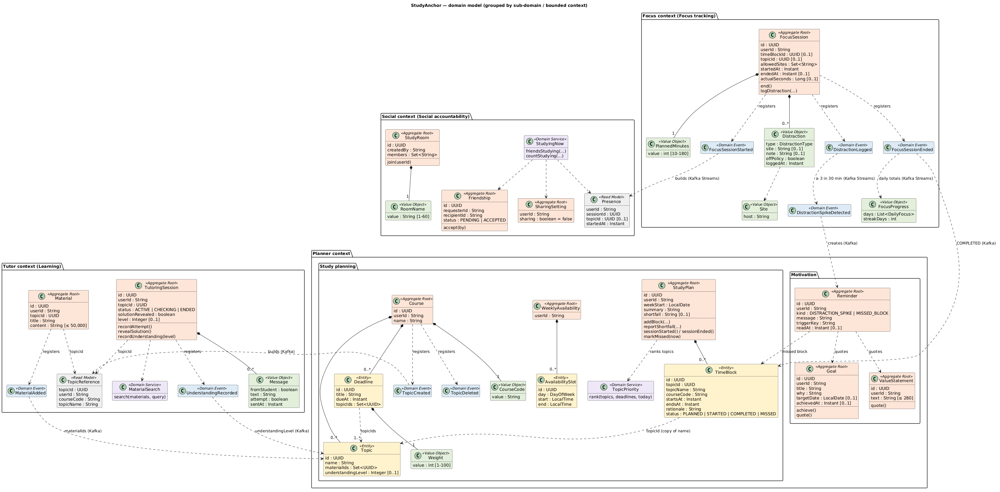

# 4. Domain-Driven Design patterns

This part names the DDD building blocks used in StudyAnchor and explains, with real code, *why* each class is the pattern it is. At the end there is a table of every domain class in all four services.

> Origin: written by Claude (AI) from the project's code, reviewed by the author. Code snippets are copied from the repo; `…` marks lines left out.

---

## 4.1 The big idea in one paragraph

Domain-Driven Design says: **put the business rules in the centre of the code, written in the business's own words, and protect them.** The words come from the glossary in [01-domain.md §6](../01-domain.md) (Course, Topic, Deadline, Focus Session, Streak, …), and the class names use exactly those words. That shared vocabulary is called the **ubiquitous language**. The rules live in the `domain` package of each service (see [part 03](03-inside-a-service.md)).



---

## 4.2 The patterns at a glance

| Pattern | One-line test: "it is this pattern if…" | Example in StudyAnchor |
|---|---|---|
| **Entity** | it has an identity that stays the same while its data changes | `Topic`, `Deadline`, `TimeBlock`, `AvailabilitySlot` |
| **Value object** | it has *no* identity; two with the same data are equal; it can't be changed | `PlannedMinutes`, `Weight`, `CourseCode`, `Site`, `RoomName`, `Distraction`, `Message` |
| **Aggregate** (+ root) | a cluster of objects that must stay consistent together, changed only through one entry object (the root) | `Course` (root) with its `Topic`s and `Deadline`s |
| **Domain event** | it records that something business-relevant *happened*, in the past tense | `FocusSessionEnded`, `TopicCreated`, `DistractionSpikeDetected` |
| **Domain service** | a business rule that doesn't belong to one object (it works across several) | `TopicPriority`, `MaterialSearch`, `StudyingNow` |
| **Repository** | it saves and loads *whole aggregates*, pretending to be an in-memory collection | `CourseRepository`, `FocusSessionRepository` |
| **Bounded context** | a boundary inside which every word has one meaning | the 4 services (part 02) |

---

## 4.3 Entity

**Definition.** An object defined by its **identity**, not by its data. A topic renamed from "Recursion" to "Recursion & Trees" is still *the same topic*.

**In the code.** `Topic`, `Deadline` (Planner); `TimeBlock`, `AvailabilitySlot` (Planner). Each has its own ID:

```java
@Entity
…
public class Deadline {

    @Id
    private UUID id;
```

**Why `Deadline` is an entity:** students refer to *this particular* assignment, its weight can be checked against others, and it can be deleted by ID (`DELETE /courses/{id}/deadlines/{deadlineId}`). Two different deadlines may have the same title and date and still be different deadlines.

**Why it is *inside* an aggregate:** `Deadline` and `Topic` are entities, but they are not aggregate roots. You can't save or load a deadline on its own; you always go through its `Course` (4.5).

---

## 4.4 Value object

**Definition.** An object defined only by its **values**. It has no ID, it never changes after it is created, and two with the same values are interchangeable, like two $5 notes. Its main job: **make invalid values impossible**.

**In the code.** Java `record`s with a check in the constructor. `planner-service/…/domain/Weight.java`:

```java
/** Implements FR-01 AC2, AC7. Value object: how much a deadline counts toward the course, 1–100 %. */
@Embeddable
public record Weight(int value) {

    public Weight {
        if (value < 1 || value > 100) {
            throw new DomainException("weight must be a whole number from 1 to 100, was " + value);
        }
    }
}
```

**Why `Weight` is a value object:** "40 %" has no identity. Any 40 % is the same as any other 40 %. And because the check is in the constructor, a `Weight` of 150 can never exist anywhere in the program.

Other value objects and the rule each one guards:

| Value object | Service | Guards |
|---|---|---|
| `PlannedMinutes` | Focus | 10–180 minutes |
| `Site` | Focus | `"https://www.YouTube.com/watch?v=1"` → `youtube.com`, so sites can be compared |
| `Distraction` | Focus | one logged interruption (type, site, note, time); lives inside `FocusSession` |
| `DailyFocus`, `FocusProgress` | Focus | a day's total; today + last 7 days + streak |
| `CourseCode` | Planner | 1–20 characters, upper-cased, so `csci318` = `CSCI318` |
| `Weight` | Planner | 1–100 % |
| `RoomName` | Social | trimmed, 1–60 characters |
| `Presence` | Social | "this student is studying now" (from events) |
| `Message` | Tutor | one line of the tutor transcript, maybe marked as an attempt |

`@Embeddable` stores a value object as columns inside its owner's table. It gets no table of its own, because it has no ID.

---

## 4.5 Aggregate and aggregate root

**Definition.** A group of objects that must **always be consistent together**. One object is the **root**: the only door in. Outside code may hold a reference to the root, but never changes the inner objects directly. One transaction changes one aggregate.

**In the code.** `planner-service/…/domain/Course.java` is the root of `Course + Topics + Deadlines`.

The rule *"a course's deadlines may add up to at most 100 %"* needs to see **all** deadlines at once, so only the root can check it:

```java
/** FR-01 AC2, AC3, AC7, AC8: due in the future (Sydney time), topics of this course, total weight ≤ 100 %. */
public Deadline addDeadline(String title, LocalDateTime dueAt, Integer weight, Collection<UUID> topicIds,
                            Instant now) {
    Instant due = StudyCalendar.toInstant(required(dueAt, "dueAt"));
    if (!due.isAfter(now)) {
        throw new DomainException("dueAt must be in the future (Australia/Sydney time)");
    }
    if (topicIds == null || topicIds.isEmpty() || !topicIds.stream().allMatch(this::hasTopic)) {
        throw new DomainException("A deadline needs one or more topic IDs of course " + code.value());
    }
    Weight w = new Weight(required(weight, "weight"));
    int total = deadlines.stream().mapToInt(d -> d.weight().value()).sum() + w.value();
    if (total > 100) {
        throw new ConflictException("Total deadline weight of " + code.value() + " would be " + total + " %");
    }
    Deadline deadline = new Deadline(title, due, w, Set.copyOf(topicIds));
    deadlines.add(deadline);
    return deadline;
}
```

**Why `Course` is the aggregate root:**
- The rules cross objects: *total weight ≤ 100 %*, *a deadline must point at topics of this course*, *a topic used by a deadline can't be deleted* (`deleteTopic` → 409), *topic names are unique within the course*.
- If `Deadline` could be saved on its own, two requests could each add 60 % and break the 100 % rule. Saving the whole course in one transaction prevents that.
- The JPA mapping matches: `@OneToMany(cascade = CascadeType.ALL, orphanRemoval = true)` means "the course's topics and deadlines are saved and deleted with it".

**Every aggregate root in the system:**

| Service | Aggregate root | Inside it | The rule that makes it one consistency unit |
|---|---|---|---|
| Planner | `Course` | `Topic`, `Deadline` | total weight ≤ 100 %; deadlines point at own topics |
| Planner | `WeeklyAvailability` | `AvailabilitySlot` | slots may not overlap (needs all slots at once) |
| Planner | `StudyPlan` | `TimeBlock` | blocks fit free time, 25–90 min, 10 min apart, one plan per week |
| Planner | `Goal`, `ValueStatement` | — | text limits; a goal is achieved once |
| Planner | `Reminder` | — | one reminder per trigger (`spike:<window>`, `missed:<block>`) |
| Tutor | `Material` | — | title and text limits; never edited |
| Tutor | `TutoringSession` | `Message`s | 2 attempts before the solution; `ACTIVE → CHECKING → ENDED` |
| Focus | `FocusSession` | `Distraction`s | distractions only while active; end once |
| Social | `Friendship` | — | no request to yourself; only the recipient accepts; accept once |
| Social | `StudyRoom` | member list | join once |
| Social | `SharingSetting` | — | one per student, off by default |

**Aggregates refer to each other by ID only.** `FocusSession` stores `timeBlockId` and `topicId` (plain UUIDs from other services), not objects. `TimeBlock` keeps a *copy* of the topic's name and course code, so a plan still reads well after a topic is deleted.

---

## 4.6 Domain event

**Definition.** A record of something that **happened** in the domain, named in the past tense. Other parts of the system react to it.

**In the code.** Immutable records that implement a common envelope (`domain/DomainEvent.java`):

```java
public interface DomainEvent {
    UUID eventId();
    String eventType();
    Instant occurredAt();
    String userId();
}
```

```java
/** Implements FR-05 and FR-10. Published to {@code focus.sessions} when a session ends. … */
public record FocusSessionEnded(
        UUID eventId, String eventType, Instant occurredAt, String userId,
        UUID sessionId, UUID timeBlockId, UUID topicId,
        long actualSeconds, Instant startedAt, Instant endedAt) implements DomainEvent {
```

**How they flow** (see part 03, steps 4–7):
1. The aggregate **registers** the event when the rule passes: `session.domainEvents.add(FocusSessionStarted.of(session))`.
2. The application service **saves**, then **publishes** via the `EventPublisher` port.
3. The infrastructure adapter sends it to Kafka as JSON.

**Why these are domain events:** "a focus session ended" is a fact the *business* cares about (progress, streaks, presence, time blocks). It is not a technical message like "row updated".

All 8 domain events: `TopicCreated`, `TopicDeleted` (Planner) · `MaterialAdded`, `UnderstandingRecorded` (Tutor) · `FocusSessionStarted`, `FocusSessionEnded`, `DistractionLogged`, `DistractionSpikeDetected` (Focus). Topics and fields: [05-events.md](../05-events.md).

---

## 4.7 Domain service

**Definition.** A business rule that **doesn't naturally belong to one entity or value object**, usually because it works across several. It has no state of its own.

**In the code.** `planner-service/…/domain/TopicPriority.java` ranks topics across *all* of a student's courses:

```java
/**
 * Implements FR-04 AC4, AC12. Domain service: ranks the student's topics so nearer, heavier deadlines and lower
 * understanding come first. Score = (6 − level, unknown counts as 3) × Σ (weight ÷ days until due, at least 1).
 */
public final class TopicPriority {
    …
    private static double score(Course course, Topic topic, Instant now) {
        double urgency = course.deadlines().stream()
                .filter(d -> d.topicIds().contains(topic.id()) && d.dueAt().isAfter(now))
                .mapToDouble(d -> d.weight().value() / Math.max(1, Duration.between(now, d.dueAt()).toMinutes() / 1440.0))
                .sum();
        int level = topic.understandingLevel() == null ? 3 : topic.understandingLevel();
        return (6 - level) * urgency;
    }
}
```

**Why it is a domain service:** the ranking needs many courses, their deadlines and each topic's understanding level. Putting it in `Topic` would make one topic know about every other course. It is still *domain* logic (a business formula), so it lives in `domain`, not in `service`.

**Worked example.** Recursion has a 40 % assignment due in 4 days and understanding level 2: score = (6 − 2) × (40 ÷ 4) = **40**. DDD has the same assignment but level 4: (6 − 4) × 10 = **20**. So the planning agent is told to study Recursion first.

The other two domain services:
- `MaterialSearch` (Tutor): finds the paragraphs of the student's own notes that share the most words with the question, so the AI tutor's hints are grounded in the student's material.
- `StudyingNow` (Social): the rules of the "studying now" board (only friends, only students who share, rooms show an anonymous count), kept out of the Kafka store so they can be tested without Kafka.

---

## 4.8 Repository

**Definition.** Looks like a collection of aggregates: "give me course X", "save this course". It hides *how* they are stored.

**In the code.** An interface in `domain` (the port), with an implementation in `infrastructure` (the adapter). See part 03, step 3.

```java
public interface CourseRepository { … }                          // domain: what we need
class JpaCourseRepositoryAdapter implements CourseRepository { … } // infrastructure: how (JPA + H2)
```

**Why:** there is one repository **per aggregate root** (never one for `Deadline`), which enforces "load and save the whole aggregate". And because the domain only sees the interface, service tests swap in an in-memory fake.

---

## 4.9 Bounded contexts and the context map

Each service is a **bounded context**: inside it, every term has one meaning and one owner.

**The same word can mean different things in different contexts.** "Topic" in Planner is a full entity with deadlines, materials and an understanding level. In Tutor, the same topic is just `TopicReference`: an ID, a name and a course code, copied from `TopicCreated` events (a *read model*). Tutor never changes it; Planner owns the rules.

| Relationship | Upstream (decides) | Downstream (follows) | How |
|---|---|---|---|
| Topics | Planner | Tutor | `TopicCreated` / `TopicDeleted` → Tutor's read model |
| Study outcomes | Tutor | Planner | `MaterialAdded`, `UnderstandingRecorded` |
| Study activity | Focus | Social, Planner | `FocusSession*`, `DistractionSpikeDetected` |
| Focus stats | Focus | Planner | REST `GET /progress/{userId}` (agent tool) |

Full map and data ownership: [03-bounded-contexts.md](../03-bounded-contexts.md).

**Why these boundaries?** Each context matches a different *activity* of the student: deciding (Planner), learning (Tutor), doing (Focus) and being with others (Social). Each changes for different reasons. A change to how streaks are counted touches only Focus. A design question that came up: goals and reminders could be their own "Motivation" context, but reminders need goals, values *and* time blocks together, so they stay in Planner (noted as a possible future split).

---

## 4.10 Every domain class, by service

**Planner** (`planner-service/…/domain/`)

| Class | Pattern |
|---|---|
| `Course` | Aggregate root |
| `Topic`, `Deadline` | Entities inside `Course` |
| `CourseCode`, `Weight` | Value objects |
| `WeeklyAvailability` | Aggregate root (one per student) |
| `AvailabilitySlot` | Entity inside `WeeklyAvailability` |
| `StudyPlan` | Aggregate root (one per student per week) |
| `TimeBlock` | Entity inside `StudyPlan` |
| `Goal`, `ValueStatement`, `Reminder` | Aggregate roots |
| `TopicCreated`, `TopicDeleted` | Domain events |
| `TopicPriority` | Domain service |
| `CourseRepository`, `GoalRepository`, `ValueStatementRepository`, `ReminderRepository`, `StudyPlanRepository`, `WeeklyAvailabilityRepository` | Repositories (ports) |
| `PlanningAgent`, `EventPublisher` | Ports (AI agent, Kafka) |
| `StudyCalendar`, `Text` | Shared helpers: Sydney time zone; the one text check |

**Tutor** (`tutor-service/…/domain/`)

| Class | Pattern |
|---|---|
| `Material` | Aggregate root |
| `TutoringSession` | Aggregate root |
| `Message` | Value object inside `TutoringSession` |
| `SessionStatus` | Enum (state: `ACTIVE → CHECKING → ENDED`) |
| `TopicReference` | Read model (copy of Planner's topic) |
| `MaterialAdded`, `UnderstandingRecorded` | Domain events |
| `MaterialSearch` | Domain service |
| `MaterialRepository`, `TutoringSessionRepository`, `TopicReferenceRepository` | Repositories (ports) |
| `TutorAgent`, `MaterialText`, `EventPublisher` | Ports (AI agent, file → text, Kafka) |

**Focus** (`focus-service/…/domain/`)

| Class | Pattern |
|---|---|
| `FocusSession` | Aggregate root |
| `Distraction` | Value object inside `FocusSession` |
| `PlannedMinutes`, `Site`, `DailyFocus`, `FocusProgress` | Value objects |
| `DistractionType` | Enum |
| `FocusSessionStarted`, `FocusSessionEnded`, `DistractionLogged`, `DistractionSpikeDetected` | Domain events |
| `FocusSessionRepository` | Repository (port) |
| `FocusHistory`, `EventPublisher` | Ports (stream store, Kafka) |
| `StudyCalendar` | Shared helper: which time zone a "day" is in |

**Social** (`social-service/…/domain/`)

| Class | Pattern |
|---|---|
| `Friendship`, `StudyRoom`, `SharingSetting` | Aggregate roots |
| `FriendshipStatus` | Enum (`PENDING → ACCEPTED`) |
| `RoomName`, `Presence` | Value objects |
| `StudyingNow` | Domain service |
| `FriendshipRepository`, `StudyRoomRepository`, `SharingSettingRepository` | Repositories (ports) |
| `PresenceBoard` | Port (stream store) |

Each service also has `DomainException` (→ 400), `ConflictException` (→ 409) and `NotFoundException` (→ 404).

---

**Next:** 05: Kafka and streams (coming) shows how events travel and how the three real-time streams work.
