# 7. Every feature, one card each (FR-01 to FR-12)

One card per functional requirement. Each card has: the user story, the objective it serves, the endpoints, **a real request and the real response**, what happens behind the scenes (which files), and the activity diagram.

> Origin: written by Claude (AI). All inputs and outputs are from a real run on **2026-10-19** against the running system, with real Gemini for FR-04 and FR-07. Student `sam-21587` and friend `kim-9473`; long IDs are shortened to `e70c…`. Full acceptance criteria: [02-requirements.md](../02-requirements.md).

**Run them yourself:** start everything ([01-run-it.md](01-run-it.md)), then use the matching Postman folder (named on each card) or the curl lines in the [README](../../README.md#sample-inputs-curl). Every request needs the header `X-User-Id: <student name>`.

**Quick index**

| FR | Feature | Service : port | Postman folder |
|---|---|---|---|
| [FR-01](#fr-01-manage-courses-topics-and-deadlines) | Courses, topics, deadlines | Planner :8081 | 1 |
| [FR-02](#fr-02-add-study-material-to-a-topic) | Study material | Tutor :8082 | 2 |
| [FR-03](#fr-03-set-weekly-study-availability) | Weekly availability | Planner :8081 | 3 |
| [FR-04](#fr-04-ai-generated-weekly-study-plan-agentic-ai) | AI weekly plan | Planner :8081 | 11 |
| [FR-05](#fr-05-start-and-end-a-focus-session) | Focus sessions | Focus :8083 | 5 |
| [FR-06](#fr-06-log-a-distraction) | Distractions | Focus :8083 | 8 |
| [FR-07](#fr-07-socratic-ai-tutor-agentic-ai) | Socratic AI tutor | Tutor :8082 | 10 |
| [FR-08](#fr-08-friends-study-rooms-and-sharing) | Friends, rooms, sharing | Social :8084 | 6 |
| [FR-09](#fr-09-live-studying-now-board-stream-processing) | "Studying now" | Social :8084 | 7 |
| [FR-10](#fr-10-real-time-focus-progress-and-streak-stream-processing) | Progress and streak | Focus :8083 | 9 |
| [FR-11](#fr-11-personal-goals-and-value-statements) | Goals and values | Planner :8081 | 4 |
| [FR-12](#fr-12-contextual-goal-reminders-stream-processing-trigger) | Reminders | Focus → Planner | 8, 11 |

---

## FR-01 Manage courses, topics and deadlines

**Story:** As a student, I want to register my courses, their topics and assessment deadlines, so the system knows what I need to study and by when.
**Objective:** O1 (reduce planning burden): planning is impossible without knowing the workload. **Service:** Planner.

**Endpoints:** `POST /courses` · `GET /courses` · `GET /courses/{id}` · `DELETE /courses/{id}` · `POST /courses/{id}/topics` · `DELETE /courses/{id}/topics/{topicId}` · `POST /courses/{id}/deadlines` · `DELETE /courses/{id}/deadlines/{deadlineId}`

**Sample**

```http
POST localhost:8081/courses
{"code":"csci318","name":"Software Engineering"}
```
```json
201 {"id":"b636…","code":"CSCI318","name":"Software Engineering","topics":[],"deadlines":[]}
```

```http
POST localhost:8081/courses/b636…/topics
{"name":"Recursion"}
```
```json
201 {"id":"e70c…","name":"Recursion","materialCount":0,"understandingLevel":null}
```

```http
POST localhost:8081/courses/b636…/deadlines
{"title":"Assignment 2","dueAt":"2026-11-02T23:59","weight":40,"topicIds":["e70c…","9e34…"]}
```
```json
201 {"id":"2747…","title":"Assignment 2","dueAt":"2026-11-02T23:59","weight":40,"topicIds":["9e34…","e70c…"]}
```

A rule being enforced: adding a 70 % exam on top of the 40 % assignment:
```json
409 {"status":409,"error":"Conflict","message":"Total deadline weight of CSCI318 would be 110 %"}
```

And Tutor already knows the topics, through the `TopicCreated` event (no REST call between them):
```http
GET localhost:8082/topics
```
```json
200 [{"topicId":"9e34…","courseCode":"CSCI318","topicName":"Domain-Driven Design"},
     {"topicId":"e70c…","courseCode":"CSCI318","topicName":"Recursion"}]
```

**Behind the scenes:** `CourseController` → `CourseService` → `Course` aggregate (`addTopic`, `addDeadline`) with value objects `CourseCode`, `Weight` → saved by `JpaCourseRepositoryAdapter` → `TopicCreated` published to `planner.topics` → Tutor's `PlannerTopicsConsumer` stores a `TopicReference`.

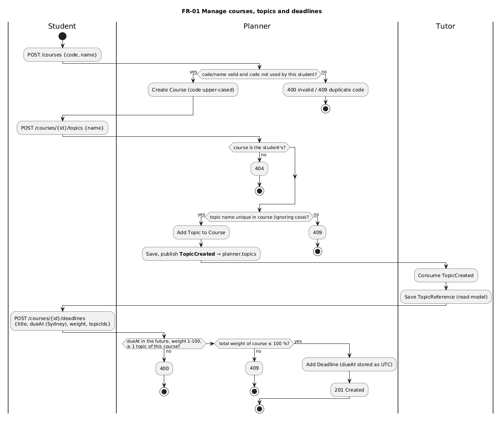

---

## FR-02 Add study material to a topic

**Story:** As a student, I want to add my lecture notes or readings to a topic, so the AI tutor can ground its help in my actual course content.
**Objective:** O2 (active learning): tutoring is more accurate when based on the student's own material. **Service:** Tutor.

**Endpoints:** `POST /topics/{topicId}/materials` (file upload: .txt, .md or .pdf) · `GET /topics/{topicId}/materials` · `GET /materials/{id}`

**Sample** (multipart form: `file` = `postman/sample-material.md`, `title` = `Week 5 lecture notes`)

```http
POST localhost:8082/topics/e70c…/materials
```
```json
201 {"materialId":"bff5…","topicId":"e70c…","title":"Week 5 lecture notes","characters":1591,"addedAt":"2026-10-18T17:40:33Z"}
```

Planner now counts it, through the `MaterialAdded` event:
```http
GET localhost:8081/courses/b636…
```
```json
200 {… "topics":[… {"id":"e70c…","name":"Recursion","materialCount":1,"understandingLevel":null}] …}
```

**Behind the scenes:** `MaterialController` → `MaterialService` → `MaterialText` port, implemented by `UploadedFileText` (reads .txt/.md, extracts .pdf text with PDFBox) → `Material` aggregate → `MaterialAdded` on `tutor.materials` → Planner's `TutorMaterialsConsumer`.

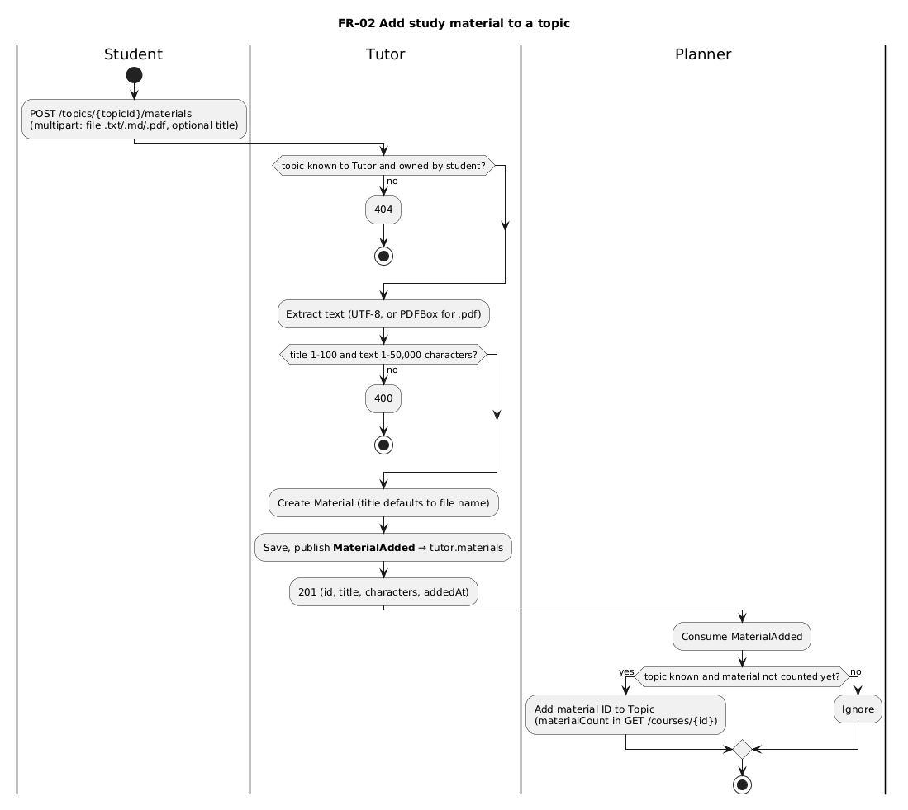

---

## FR-03 Set weekly study availability

**Story:** As a student, I want to tell the system when I'm available to study each week, so plans fit my real life.
**Objective:** O1: unrealistic plans are abandoned. **Service:** Planner.

**Endpoints:** `POST /availability/slots` · `DELETE /availability/slots/{slotId}` · `GET /availability`

**Sample**

```http
POST localhost:8081/availability/slots
{"day":"MONDAY","start":"09:00","end":"12:00"}
```
```json
201 {"id":"7952…","day":"MONDAY","start":"09:00","end":"12:00"}
```

An overlapping slot is refused:
```http
POST localhost:8081/availability/slots
{"day":"MONDAY","start":"11:00","end":"13:00"}
```
```json
409 {"status":409,"error":"Conflict","message":"The slot overlaps another slot on MONDAY"}
```

```http
GET localhost:8081/availability
```
```json
200 {"userId":"sam-21587","slots":[{"id":"7952…","day":"MONDAY","start":"09:00","end":"12:00"},
                                  {"id":"36c1…","day":"WEDNESDAY","start":"14:00","end":"16:00"}]}
```

**Behind the scenes:** `AvailabilityController` → `AvailabilityService` → `WeeklyAvailability` aggregate (one per student; it sees all slots, so it checks overlap) holding `AvailabilitySlot` entities.

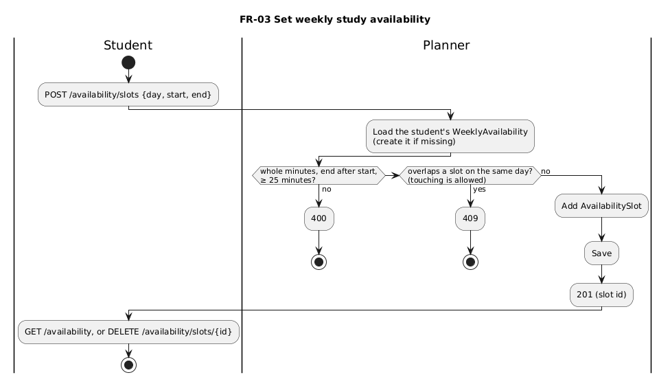

---

## FR-04 AI-generated weekly study plan (Agentic AI)

**Story:** As a student, I want the system to build my week's study time blocks for me, so I don't get stuck deciding what to study.
**Objective:** O1: removes the planning step that ADHD makes hardest. **Service:** Planner (+ REST call to Focus). Needs `LLM_API_KEY`.

**Endpoints:** `POST /plans` (`weekStart` must be a Monday; `"replace": true` to redo a week) · `GET /plans/{weekStart}`

**Sample**

```http
POST localhost:8081/plans
{"weekStart":"2026-10-19"}
```
```json
201 {"id":"5303…","weekStart":"2026-10-19",
     "summary":"I've set up four manageable, 45-minute focus sessions for you this week (Monday and Wednesday) to tackle Domain-Driven Design and Recursion for your CSCI318 Assignment 2. Since your focus streak is just starting, these shorter chunks will help you build momentum without burning out. You've got this!",
     "shortfall":null,"totalMinutes":180,
     "blocks":[
       {"date":"2026-10-19","day":"MONDAY","start":"09:15","end":"10:00","minutes":45,"topicName":"Domain-Driven Design","courseCode":"CSCI318",
        "rationale":"This topic is high priority for your upcoming CSCI318 Assignment 2 with 40% weight.","status":"PLANNED"},
       {"date":"2026-10-19","day":"MONDAY","start":"10:15","end":"11:00","minutes":45,"topicName":"Recursion", … ,"status":"PLANNED"},
       {"date":"2026-10-21","day":"WEDNESDAY","start":"14:00","end":"14:45","minutes":45,"topicName":"Domain-Driven Design", …},
       {"date":"2026-10-21","day":"WEDNESDAY","start":"15:00","end":"15:45","minutes":45,"topicName":"Recursion", …}]}
```

The agent's tool calls (planner window):
```
Tool getDeadlines    → CSCI318 "Assignment 2" due 2026-11-02T23:59, weight 40 %, topics: Domain-Driven Design, Recursion
Tool getAvailability → MONDAY 2026-10-19: 09:00–12:00 …
Tool getTopics       → 1. Domain-Driven Design (CSCI318), …, understanding unknown, priority 8.1 …
Tool getFocusStats   → Today: 0m 13s. Last 7 days: … Streak: 0 day(s).
Tool addBlocks(4)    → Added 4 block(s); the plan now has 4 block(s).
```

Every block sits inside a free slot, is 25–90 minutes, and has at least 10 minutes between blocks. The code checks all of this, not the prompt. Asking again for the same week, the student is asked to confirm:
```json
409 {"status":409,"error":"Conflict","message":"You already have a plan for the week of 2026-10-19 with 4 block(s). To replace it, send the request again with \"replace\": true."}
```

**Behind the scenes:** `StudyPlanController` → `StudyPlanService.generate` → `PlanningAgent` port, implemented by `GeminiPlanningAgent` (LangChain4j) with `PlanningTools` → `StudyPlan.addBlock` enforces the rules; `TopicPriority` ranks topics; `FocusProgressClient` calls Focus. Details: [part 06](06-ai-agents.md).

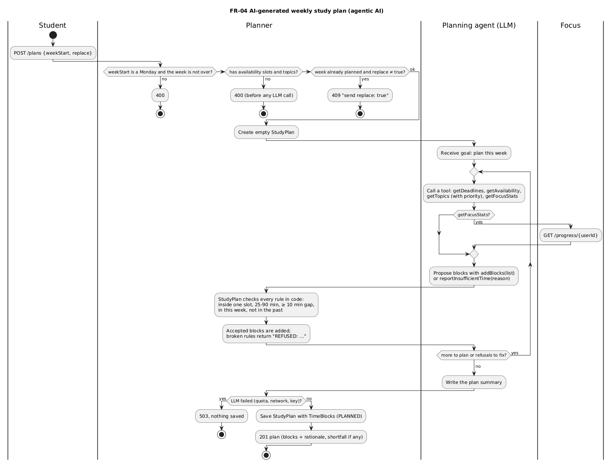

---

## FR-05 Start and end a focus session

**Story:** As a student, I want to start and stop a timed focus session, so my study time is tracked.
**Objective:** O3 (sustained focus): tracking is the basis of feedback and habits. **Service:** Focus.

**Endpoints:** `POST /sessions` · `POST /sessions/{id}/end` · `GET /sessions/{id}`

**Sample**

```http
POST localhost:8083/sessions
{"topicId":"e70c…","plannedMinutes":25,"allowedSites":["https://docs.oracle.com/javase"]}
```
```json
201 {"id":"5ae7…","userId":"sam-21587","timeBlockId":null,"topicId":"e70c…","plannedMinutes":25,
     "allowedSites":["docs.oracle.com"],"status":"ACTIVE","startedAt":"2026-10-18T17:40:41Z",
     "endedAt":null,"actualDuration":null,"actualSeconds":null,"distractions":[]}
```
(The site was cleaned to its host by the `Site` value object.)

Only one active session per student:
```json
409 {"status":409,"error":"Conflict","message":"User sam-21587 already has an active focus session"}
```

```http
POST localhost:8083/sessions/5ae7…/end
```
```json
200 {"id":"5ae7…","status":"ENDED","startedAt":"2026-10-18T17:40:41Z","endedAt":"2026-10-18T17:40:54Z",
     "actualDuration":"0m 13s","actualSeconds":13,"distractions":[…3 items, see FR-06…]}
```

**Behind the scenes:** traced step by step in [part 03](03-inside-a-service.md). `FocusSessionStarted` / `FocusSessionEnded` go to `focus.sessions` → Social (FR-09), Focus's progress stream (FR-10), Planner time blocks (FR-12).

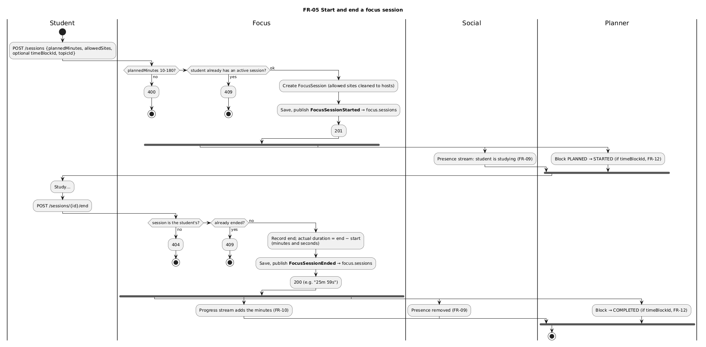

---

## FR-06 Log a distraction

**Story:** As a student, I want to quickly log when I get distracted, so I can see my patterns and get support.
**Objective:** O3: awareness of distraction is the first step to reducing it. **Service:** Focus.

**Endpoint:** `POST /sessions/{id}/distractions`. Types: `PHONE`, `SOCIAL_MEDIA`, `OTHER_SITE`, `THOUGHT`, `OTHER`.

**Sample**

```http
POST localhost:8083/sessions/5ae7…/distractions
{"type":"OTHER_SITE","site":"https://www.youtube.com/watch?v=1","note":"Clicked a video"}
```
```json
201 {"type":"OTHER_SITE","site":"youtube.com","note":"Clicked a video","offPolicy":true,"loggedAt":"2026-10-18T17:40:47Z"}
```

```http
POST localhost:8083/sessions/5ae7…/distractions
{"type":"PHONE"}
```
```json
201 {"type":"PHONE","site":null,"note":null,"offPolicy":false,"loggedAt":"2026-10-18T17:40:47Z"}
```

`offPolicy: true` means the site is not in the session's allowed sites (`docs.oracle.com`). This is how website blocking is modelled without building a blocker.

**Behind the scenes:** `FocusSession.logDistraction` (only while active, else 409) → `Distraction` value object → `DistractionLogged` on `focus.distractions` → the spike stream (FR-12).

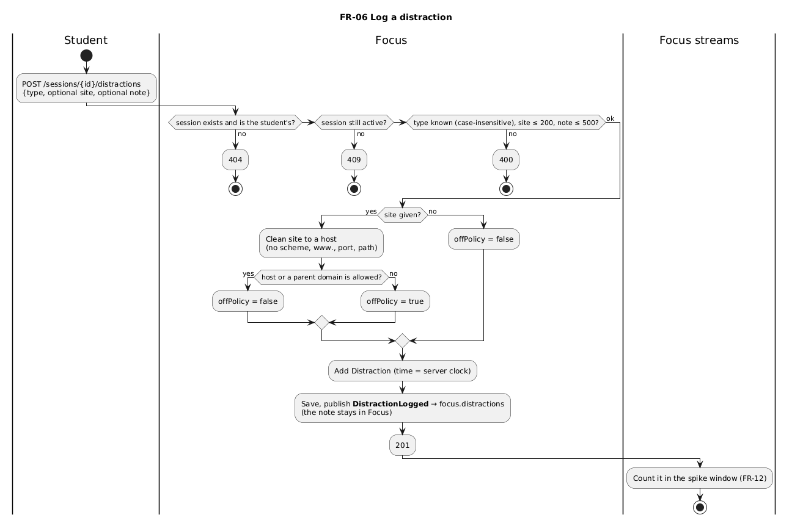

---

## FR-07 Socratic AI tutor (Agentic AI)

**Story:** As a student, I want an AI tutor that guides me with questions and hints instead of giving me the answer, so I actually learn.
**Objective:** O2: counters passive "skip to the answer" AI use. **Service:** Tutor. Needs `LLM_API_KEY`.

**Endpoints:** `POST /tutoring-sessions` · `POST /tutoring-sessions/{id}/messages` · `POST /tutoring-sessions/{id}/end` · `GET /tutoring-sessions/{id}`

**Sample conversation** (real Gemini replies; responses trimmed to the key fields):

| Student sends | Tutor state after | Tutor reply (shortened) |
|---|---|---|
| `POST /tutoring-sessions` `{"topicId":"e70c…","question":"How do I write a recursive method that sums a list?"}` | ACTIVE, attempts 0 | "…we always need two key parts: a base case and a recursive case. According to your 'Week 5 lecture notes,' … what is the simplest input we can answer directly…?" |
| "Just give me the answer please." | ACTIVE, attempts **0** | "I know it can feel tempting to jump straight to the answer, but you'll understand it so much better if we build it together!…" |
| "The base case is the empty list, which returns 0." | ACTIVE, attempts **1** | "Spot on! … if our list isn't empty, how can we break it down into a smaller piece…?" |
| "sum(list) = first + sum(rest of the list)." | ACTIVE, attempts **2** | "Nailed it! You've got both parts…" |
| "Now can I see the full solution?" | ACTIVE, **solutionRevealed: true** | "Here is the full solution we just built together: `public int sumList(List<Integer> list) { if (list.isEmpty()) return 0; return list.get(0) + sumList(list.subList(1, list.size())); }`…" |
| `POST …/end` | **CHECKING** | "Before you go, can you tell me in your own words why we need a base case…?" |
| "Each call works on a shorter list until it reaches the empty list, which returns 0 without recursing, so it stops." | **ENDED, understandingLevel 5** | "Fantastic! You gave that a 5 out of 5…" |

The tool log for this conversation (tutor window). Note the **refusal**: the LLM tried to grade before asking its check question, and the code said no:
```
Tool recordAttempt → Attempt recorded. The student has made 1 attempt(s).
Tool recordAttempt → Attempt recorded. The student has made 2 attempt(s).
Tool revealSolution → Solution to share with the student: …
Tool recordUnderstanding(5) → REFUSED: Ask one check-understanding question and wait for the student's answer before grading
Tool recordUnderstanding(5) → Level 5 recorded; the session has ended. …
```

Planner received the level through the `UnderstandingRecorded` event:
```json
GET localhost:8081/courses/b636…  →  … {"name":"Recursion","materialCount":1,"understandingLevel":5} …
```

**Behind the scenes:** `TutoringController` → `TutoringService` → `TutorAgent` port, implemented by `GeminiTutorAgent` with `TutoringTools` → `TutoringSession` aggregate enforces 2 attempts and the state order → `UnderstandingRecorded` on `tutor.understanding` → Planner's `TutorUnderstandingConsumer`. Details: [part 06](06-ai-agents.md).

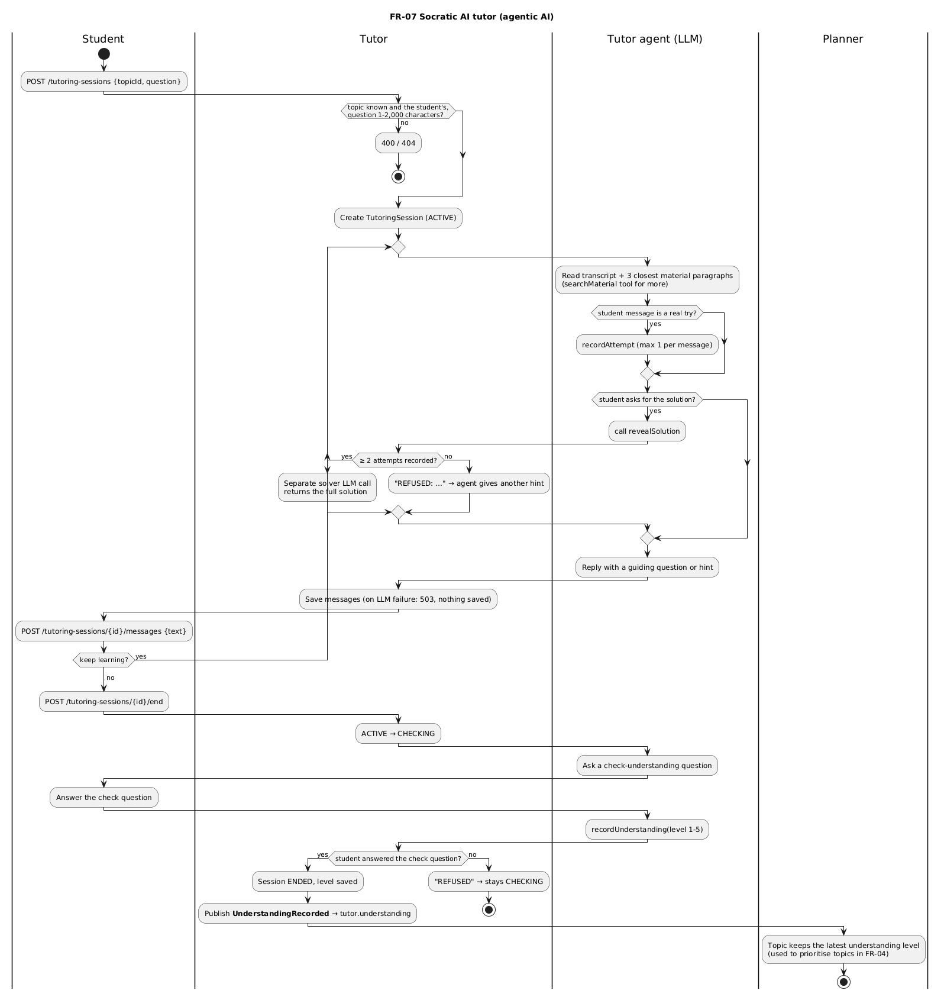

---

## FR-08 Friends, study rooms and sharing

**Story:** As a student, I want to connect with friends and join study rooms, so I don't study alone.
**Objective:** O4 (reduce isolation). **Service:** Social.

**Endpoints:** `POST /friends/requests` · `GET /friends/requests` · `POST /friends/requests/{id}/accept` · `GET /friends` · `POST /rooms` · `POST /rooms/{id}/join` · `GET /rooms/{id}` · `PUT /sharing` · `GET /sharing`

**Sample**

```http
POST localhost:8084/friends/requests        (X-User-Id: kim-9473)
{"toUserId":"sam-21587"}
```
```json
201 {"id":"8f18…","fromUserId":"kim-9473","toUserId":"sam-21587","status":"PENDING","requestedAt":"…","acceptedAt":null}
```

```http
POST localhost:8084/friends/requests/8f18…/accept      (X-User-Id: sam-21587)
```
```json
200 {"id":"8f18…","fromUserId":"kim-9473","toUserId":"sam-21587","status":"ACCEPTED", … }
```

```http
PUT localhost:8084/sharing                  (X-User-Id: sam-21587)
{"sharing":true}
```
```json
200 {"userId":"sam-21587","sharing":true}
```

```http
POST localhost:8084/rooms                   (X-User-Id: sam-21587)
{"name":"CSCI318 study group"}
```
```json
201 {"id":"0afd…","name":"CSCI318 study group","createdBy":"sam-21587","members":["sam-21587"]}
```
Then `POST /rooms/0afd…/join` as kim → `"members":["kim-9473","sam-21587"]`.

**Behind the scenes:** `FriendController` / `StudyRoomController` / `SharingController` → their services → aggregates `Friendship` (only the recipient accepts; no request to yourself), `StudyRoom` (join once), `SharingSetting` (off by default).

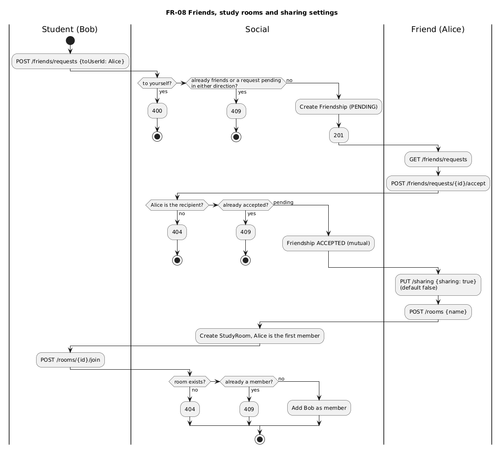

---

## FR-09 Live "studying now" board (Stream processing)

**Story:** As a student, I want to see which friends are studying right now, so I feel accompanied and motivated to start.
**Objective:** O4. **Service:** Social (Kafka Streams over `focus.sessions`).

**Endpoints:** `GET /friends/studying-now` · `GET /rooms/{id}/studying-now`

**Sample** (while sam's focus session from FR-05 is open; kim asks)

```http
GET localhost:8084/friends/studying-now     (X-User-Id: kim-9473)
```
```json
200 {"userId":"kim-9473","friendsStudying":[{"userId":"sam-21587","topicId":"e70c…",
     "startedAt":"2026-10-18T17:40:41Z","elapsed":"0m 5s","elapsedSeconds":5}]}
```

```http
GET localhost:8084/rooms/0afd…/studying-now   (X-User-Id: kim-9473)
```
```json
200 {"roomId":"0afd…","roomName":"CSCI318 study group","studyingCount":1,"memberCount":2}
```

After sam ends the session, sam disappears from the board (the tombstone in [part 05 §5.6](05-kafka-and-streams.md)). If sam turns sharing off, kim's board hides sam at once; the room still counts sam as an anonymous number.

**Behind the scenes:** `PresenceTopology` (KTable `presence-store`) → `KafkaStreamsPresenceBoard` (interactive query) → `StudyingNow` domain service applies friends + sharing rules.

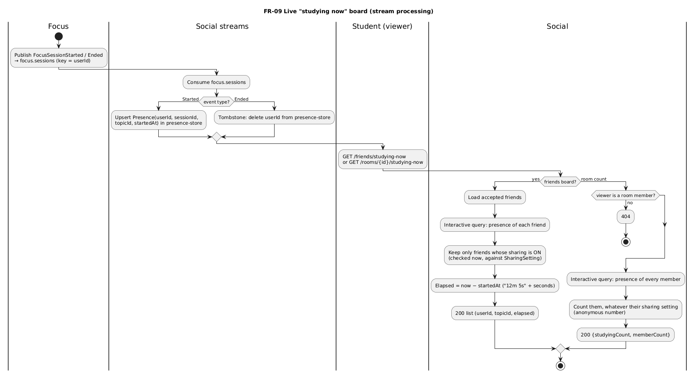

---

## FR-10 Real-time focus progress and streak (Stream processing)

**Story:** As a student, I want to see my focus minutes today, this week and my streak, so I can see that I'm improving.
**Objective:** O3. **Service:** Focus (Kafka Streams over `focus.sessions`).

**Endpoint:** `GET /progress/{userId}` (no header needed; it also opens in a browser)

**Sample** (seconds after sam's 13-second session ended)

```http
GET localhost:8083/progress/sam-21587
```
```json
200 {"userId":"sam-21587","today":{"date":"2026-10-19","focus":"0m 13s","seconds":13},
     "last7Days":[{"date":"2026-10-13","focus":"0m 0s","seconds":0}, … ,{"date":"2026-10-19","focus":"0m 13s","seconds":13}],
     "streakDays":0}
```

`streakDays` counts consecutive Sydney days with at least 25 minutes, so 13 seconds doesn't count yet. Dates are Sydney days (it is already 19 October in Sydney while the UTC timestamps still say the 18th).

**Behind the scenes:** `FocusProgressTopology` (1-day windows, Sydney-aligned) → `KafkaStreamsFocusHistory` (interactive query) → `FocusProgress` value object computes today, last 7 days and streak. Details: [part 05 §5.5](05-kafka-and-streams.md).

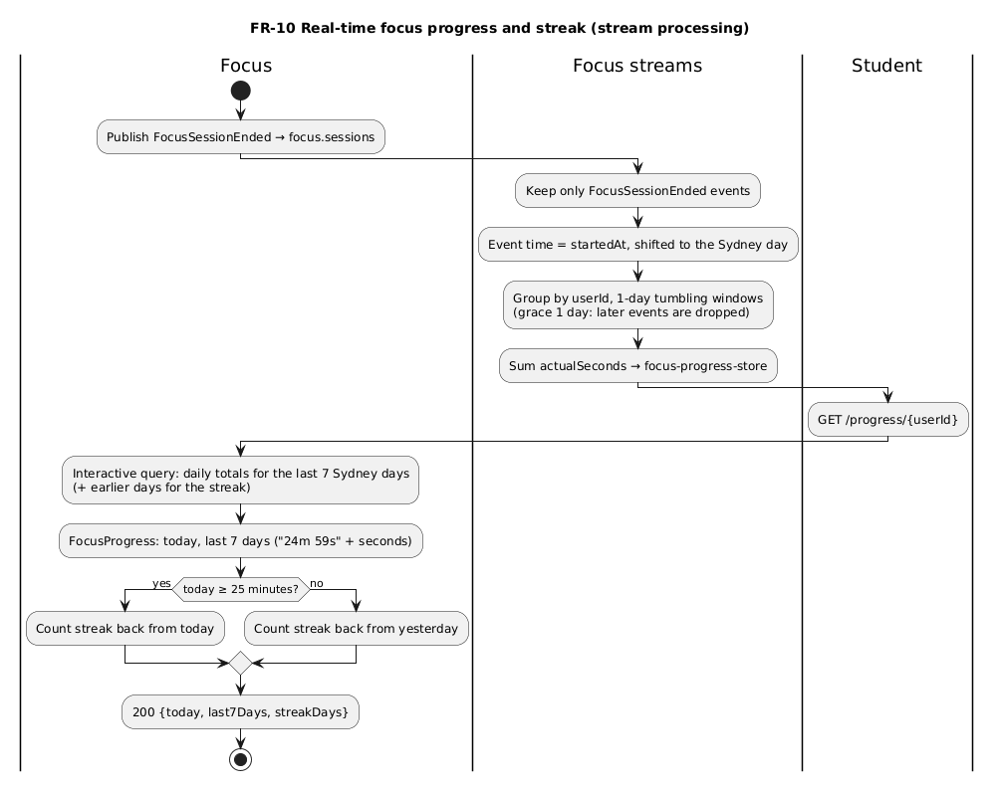

---

## FR-11 Personal goals and value statements

**Story:** As a student, I want to write down my goals and the ideas that matter to me, so the system can remind me why I'm studying.
**Objective:** O5 (keep motivation anchored). **Service:** Planner.

**Endpoints:** `POST /goals` · `GET /goals` · `POST /goals/{id}/achieve` · `DELETE /goals/{id}` · `POST /values` · `GET /values` · `DELETE /values/{id}`

**Sample**

```http
POST localhost:8081/goals
{"title":"Pass CSCI318 with a distinction","why":"I want to prove I can finish what I start."}
```
```json
201 {"id":"d636…","title":"Pass CSCI318 with a distinction","why":"I want to prove I can finish what I start.","targetDate":null,"achievedAt":null}
```

```http
POST localhost:8081/values
{"text":"Learning is how I take care of my future self."}
```
```json
201 {"id":"a136…","text":"Learning is how I take care of my future self."}
```

**Behind the scenes:** `MotivationController` → `MotivationService` → aggregates `Goal` (achieve once, else 409) and `ValueStatement` (1–280 characters). Their `quote()` is used by reminders (FR-12).

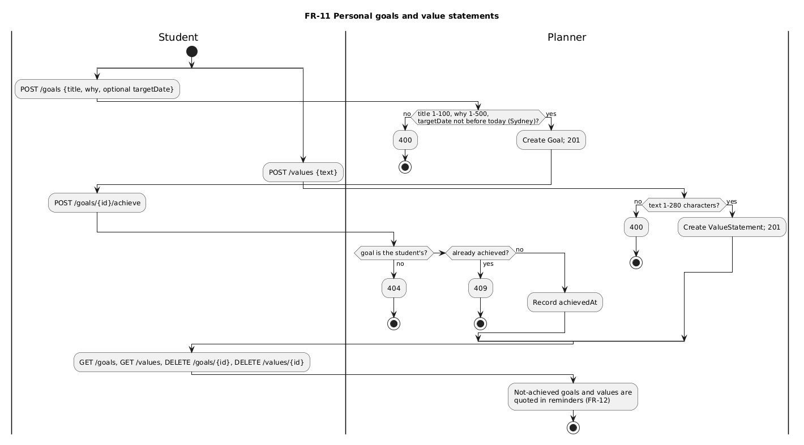

---

## FR-12 Contextual goal reminders (Stream processing trigger)

**Story:** As a student, I want reminders of my own goals and values when I'm struggling, or at random times, so I stay connected to my purpose.
**Objectives:** O5 and O3. **Services:** Focus (spike stream) → Planner (reminders, time blocks).

**Endpoints:** `GET /reminders` · `POST /reminders/{id}/read`

**Sample:** after the 3 distractions in FR-06 (within one 30-minute window), with nothing else sent:

```http
GET localhost:8081/reminders
```
```json
200 [{"id":"e599…","kind":"DISTRACTION_SPIKE",
      "message":"You logged 3 distractions in half an hour. Take a short break, then start again. Remember \"Learning is how I take care of my future self.\".",
      "createdAt":"2026-10-18T17:40:48Z","readAt":null}]
```

The reminder appeared **within a second** of the third distraction, and it quotes the student's own value statement from FR-11. The chain (logs):
```
focus   : Detected DistractionSpikeDetected for user sam-21587: 3 distractions in 17:30:00Z – 18:00:00Z
planner : Received DistractionSpikeDetected for user sam-21587: 3 distractions in 17:30:00Z – 18:00:00Z
```

**Time blocks (with FR-04):** a focus session started with a block's `timeBlockId` marks it `STARTED`, then `COMPLETED` when it ends. A block that ends with no session is marked `MISSED` within a minute and gets a `MISSED_BLOCK` reminder. Postman folder 11 shows `COMPLETED`; the `MISSED` test was run live on 2026-10-14 (see progress.md).

**Behind the scenes:** `DistractionSpikeTopology` (30-min windows, fires at exactly 3) → `focus.alerts` → Planner's `FocusAlertsConsumer` → `ReminderService` → `Reminder` aggregate (one per `triggerKey`, quotes a goal or value). Missed blocks: `MissedBlockScheduler` → `StudyPlanService.markMissedBlocks`. Details: [part 05 §5.7](05-kafka-and-streams.md).

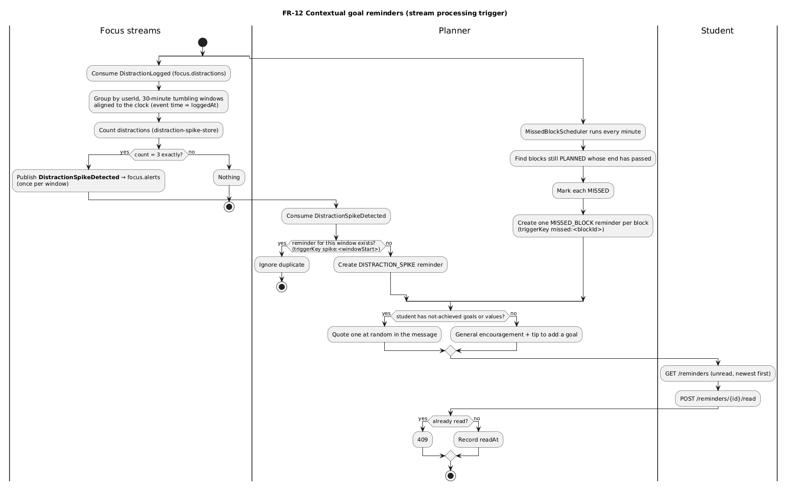

---

**This is the last part of the guide.** Start again at [01: Run it](01-run-it.md), or see [02: Big picture](02-big-picture.md) for how the features fit together.
